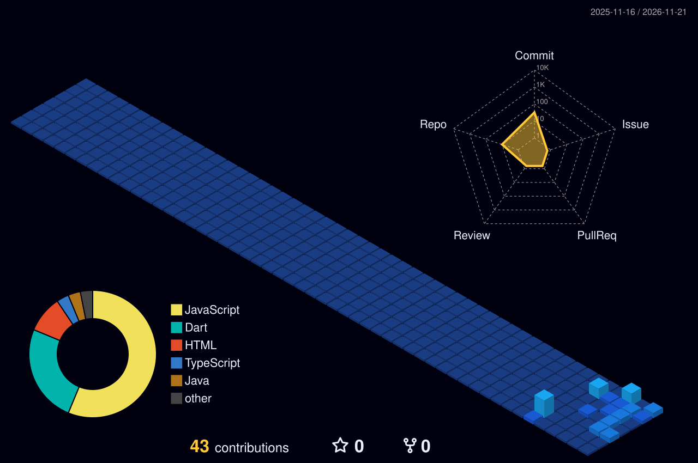
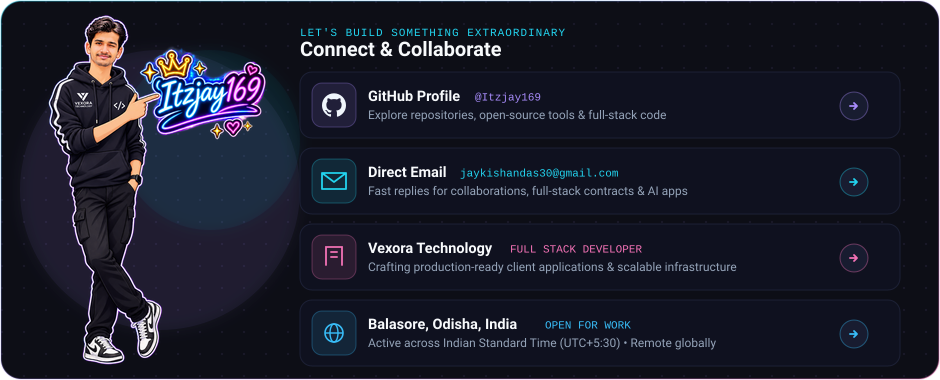

  <!-- 1. HERO BANNER -->
  

      
  

   

  <!-- 2. ABOUT & CAPABILITIES & HOBBIES -->
  

    
  

   

  <!-- 3. ORBITAL TECH STACK GALAXY -->
  

    
  

   

  <!-- 4. 3D CONTRIBUTION CITY (NIGHT VIEW) -->
  

    
  

   

  <!-- 5. ID BADGE & LIVE DASHBOARD -->
  

    
  

   

---

### 🚀 Featured Engineering Projects

| Project | Description | Tech Stack | Status / Links |
| :--- | :--- | :--- | :---: |
| 🔮 **[AI Assistant Suite](https://github.com/Itzjay169)** | Multi-agent autonomous developer workspace featuring reactive tool scheduling, local LLM integration, and real-time streaming interfaces. | `React.js` `Node.js` `Antigravity` `Firebase` |  |
| 🏢 **[Vexora Enterprise Engine](https://github.com/Itzjay169)** | Scalable business automation & CRM platform engineered for client operations, secure role-based access, and real-time database synchronization. | `Node.js` `Express.js` `Firebase` `REST APIs` |  |
| 💻 **[OmniDesktop Studio](https://github.com/Itzjay169)** | High-efficiency cross-platform desktop application designed for creative developers, system instrumentation, and low-latency workflows. | `Java` `JavaScript` `Desktop App` `CSS3` |  |
| 🌌 **[Aurora Glass UI System](https://github.com/Itzjay169)** | Midnight glassmorphism component system built with 60fps SMIL animations, declarative SVGs, and responsive design tokens. | `HTML5` `CSS3` `React` `Responsive Design` |  |

 

  <!-- 6. CHARACTER CONNECT & LINKS -->
  

    
  

   

  <!-- Quick Action Badges -->
  
  &nbsp;
  
  &nbsp;
  
  &nbsp;
  

    

  ⚡ Crafted with precision by <b>Jaykishan Das</b> • Engineered with declarative pure SVG &amp; SMIL animations • Zero external network dependencies.

# 💫 About Me:
👋 Hi, I'm Jaykishan Das  💻 Software Developer | Full-Stack Developer | AI/ML & Cyber Security Enthusiast  I'm a passionate developer who enjoys building innovative software, web applications, and AI-powered solutions. I love turning ideas into practical projects and continuously exploring new technologies.  🚀 Currently working on: Full-Stack Development, AI-powered applications, and real-world software solutions.  🛠️ Technical Skills  - Programming Languages: C, Java, Python, JavaScript - Frontend Development: HTML, CSS, JavaScript, React - Backend Development: Node.js, Express.js, Java - AI & Machine Learning: Python, Scikit-learn, Pandas, NumPy - Database & Cloud: Firebase, SQL - Tools & Platforms: Git, GitHub, VS Code, Antigravity - Other Interests: REST APIs, Cybersecurity, Automation, UI/UX  🎯 What I'm Focused On  - Building real-world software projects. - Improving Full-Stack Development skills. - Exploring Artificial Intelligence and Machine Learning. - Learning software engineering and cybersecurity. - Creating technology that solves real-world problems.  🌐 Connect With Me  - 💼 LinkedIn: [Jaykishan Das](https://linkedin.com/in/jaykishandas) - 💻 GitHub: [@Itzjay169](https://github.com/Itzjay169)   ---  Turning ideas into code, and code into innovation.

## 🌐 Socials:
  

# 💻 Tech Stack:
                               
# 📊 GitHub Stats:
 
 

---

<!-- Proudly created with GPRM ( https://gprm.itsvg.in ) -->